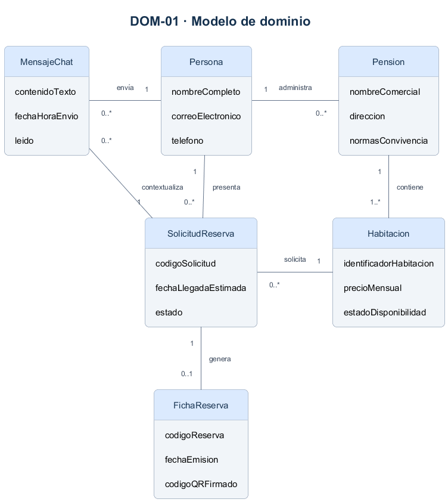

# Modelo de dominio

## DOM-01 — Modelo de dominio de BuscaTuNido

Archivo fuente: [modelo-dominio.puml](./diagramas/modelo-dominio.puml)

El diagrama muestra los atributos esenciales. La tabla siguiente conserva el detalle completo; estudiante y dueño son roles de Persona.

## Descripción de las clases

| Clase | Qué representa en el negocio | Atributos |
|-------|------------------------------|-----------|
| Persona | Persona que participa como estudiante postulante, arrendador o ambos. | nombreCompleto, correoElectronico, telefono, correoInstitucional, universidad, carrera |
| Pension | Inmueble que ofrece alojamiento a estudiantes. | nombreComercial, direccion, comuna, coordenadasGeograficas, normasConvivencia, serviciosIncluidos |
| Habitacion | Espacio ofrecido en arriendo dentro de una pensión. | identificadorHabitacion, precioMensual, tipoCama, tieneBanoPrivado, estadoDisponibilidad |
| SolicitudReserva | Postulación de una persona a una habitación para una fecha y duración determinadas. | codigoSolicitud, fechaLlegadaEstimada, duracionEstadiaMeses, mensajePresentacion, fechaEnvio, estado |
| FichaReserva | Comprobante de una solicitud aprobada, con código de verificación firmado. | codigoReserva, fechaEmision, codigoQRFirmado, estadoFicha |
| MensajeChat | Mensaje de coordinación de llegada asociado a una solicitud aprobada. | contenidoTexto, fechaHoraEnvio, leido |

## Asociaciones

| Asociación | Clases | Multiplicidades | Justificación |
|------------|--------|-----------------|---------------|
| administra | Persona – Pension | 1 a 0..* | Cada pensión tiene un arrendador responsable; una persona puede no administrar ninguna o administrar varias. |
| contiene | Pension – Habitacion | 1 a 1..* | Cada habitación pertenece a una pensión; cada pensión publicada ofrece al menos una habitación. |
| presenta | Persona – SolicitudReserva | 1 a 0..* | Cada solicitud tiene un único postulante; una persona puede presentar varias solicitudes. |
| solicita | SolicitudReserva – Habitacion | 0..* a 1 | Cada solicitud corresponde a una habitación; una habitación puede recibir varias postulaciones a lo largo del tiempo. |
| genera | SolicitudReserva – FichaReserva | 1 a 0..1 | Cada ficha corresponde a una solicitud aprobada; una solicitud tiene como máximo una ficha, reutilizada en las descargas. |
| contextualiza | SolicitudReserva – MensajeChat | 1 a 0..* | Cada mensaje pertenece a una solicitud; solo una solicitud aprobada habilita el chat. |
| envia | Persona – MensajeChat | 1 a 0..* | Cada mensaje tiene exactamente un remitente, que es el postulante o el arrendador de la pensión de esa solicitud. |

## Decisiones de modelado

- Estudiante y dueño son roles de `Persona`, expresados como postulante y arrendador en las asociaciones. No son clases ni subtipos excluyentes: una misma persona puede asumir ambos roles. Los datos académicos son opcionales para una persona en general y obligatorios al postular según HU-02.
- Se usan asociaciones simples, sin herencia, agregación ni composición. Dar de baja una oferta no implica destruir la habitación física ni eliminar solicitudes, fichas o conversaciones históricas.
- Los atributos representan información del negocio, sin métodos ni modificadores de visibilidad. No se incluyen cuentas bancarias porque el alcance no contempla pagos.
- `EstadoSolicitud` corresponde a los estados de EST-01: En revisión, Aprobada, Rechazada y Expirada. `EstadoHabitacion` corresponde a EST-02: Disponible, Reservada y Ocupada.
- Puede haber varias solicitudes para una habitación, pero la aprobación exige disponibilidad y bloquea el cupo para impedir aprobaciones incompatibles. Una solicitud pendiente o rechazada no habilita ficha ni chat.
