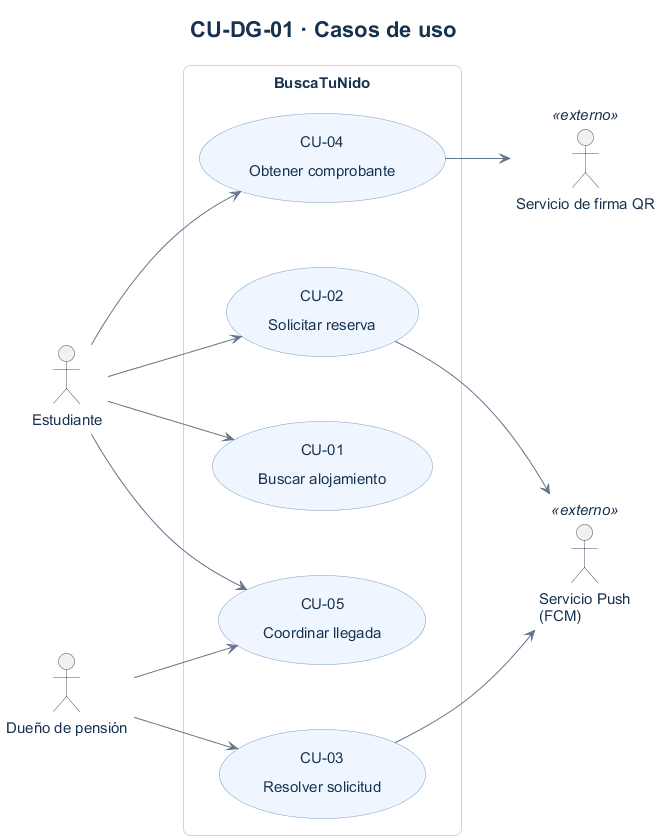

# Casos de uso

## Actores

| Actor | Tipo (humano / sistema externo) | Descripción |
|-------|----------------------------------|-------------|
| **Estudiante** | Humano | Estudiante de educación superior foráneo que explora alojamientos, envía solicitudes formales y coordina su llegada. |
| **Dueño de Pensión** | Humano | Arrendador o administrador del inmueble que recibe postulaciones móviles, aprueba o rechaza cupos y entrega habitaciones. |
| **Servicio Push (FCM)** | Sistema externo | Plataforma Firebase Cloud Messaging encargada de despachar alertas en tiempo real a los dispositivos móviles de estudiantes y dueños. |
| **Servicio Criptográfico QR** | Sistema externo | Entidad de firma digital encargada de emitir y verificar sellos criptográficos asimétricos para validación de fichas sin conexión a internet. |

## CU-DG-01 — Diagrama de casos de uso

Archivo fuente: [`./diagramas/casos-de-uso.puml`](./diagramas/casos-de-uso.puml)

## Casos de uso y su origen

| ID | Caso de uso (objetivo del actor) | Actor principal | Historia de origen |
|----|-----------------------------------|-----------------|---------------------|
| **CU-01** | Buscar alojamiento | Estudiante | [`HU-01`](./04-historias-usuario.md#hu-01--filtrar-catálogo-por-campus-precio-y-normas) |
| **CU-02** | Solicitar reserva | Estudiante | [`HU-02`](./04-historias-usuario.md#hu-02--enviar-solicitud-formal-de-reserva) |
| **CU-03** | Resolver solicitud | Dueño de Pensión | [`HU-03`](./04-historias-usuario.md#hu-03--revisar-solicitud-y-resolver-postulación-desde-el-móvil) |
| **CU-04** | Obtener comprobante | Estudiante | [`HU-04`](./04-historias-usuario.md#hu-04--recibir-confirmación-y-coordinar-llegada-por-chat) |
| **CU-05** | Coordinar llegada | Estudiante / Dueño | [`HU-04`](./04-historias-usuario.md#hu-04--recibir-confirmación-y-coordinar-llegada-por-chat) |

## Alcance de los casos de uso

El diagrama presenta cinco objetivos del usuario. Las validaciones, el bloqueo del cupo y la firma del comprobante forman parte de sus flujos; no se muestran como casos de uso independientes. No se necesitan relaciones include/extend para esta vista.

- **CU-01 — Buscar alojamiento:** filtrar el catálogo por campus, precio y normas.
- **CU-02 — Solicitar reserva:** validar antecedentes y disponibilidad, registrar la solicitud y notificar al dueño mediante FCM.
- **CU-03 — Resolver solicitud:** aprobar solo si hay cupo, bloquearlo y notificar al estudiante; o rechazar y enviar alternativas. Rechazar no bloquea ni libera cupos de otras reservas.
- **CU-04 — Obtener comprobante:** requiere una solicitud aprobada. La primera emisión usa el servicio de firma QR; las descargas posteriores reutilizan la ficha. La verificación presencial puede hacerse sin conexión.
- **CU-05 — Coordinar llegada:** habilitar el chat exclusivamente entre el postulante y el arrendador de una solicitud aprobada.

Los actores externos apoyan al sistema: FCM entrega notificaciones y el servicio QR firma el comprobante. Los actores humanos conservan sus roles de estudiante y dueño.
