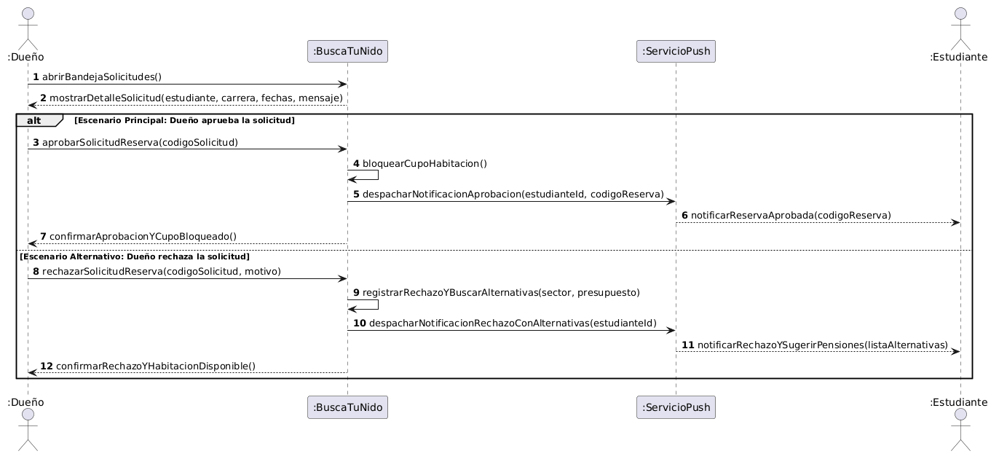
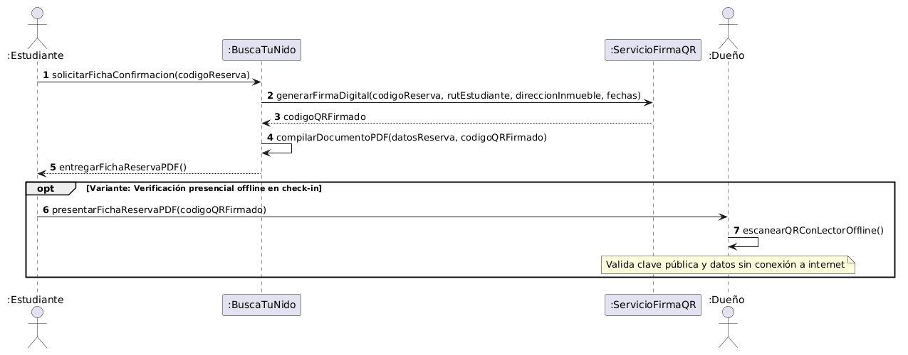

# Diagramas de secuencia de sistema

## DSS-01 — Resolución de postulación de reserva (Aprobación / Rechazo)

- **Caso de uso:** [`CU-03`](./09-casos-de-uso.md)
- **Historia:** [`HU-03`](./04-historias-usuario.md#hu-03--revisar-solicitud-y-resolver-postulación-desde-el-móvil)
- **Sistemas externos que participan:** Servicio Push (Firebase Cloud Messaging - FCM)

Archivo fuente: [`./diagramas/dss-01.puml`](./diagramas/dss-01.puml)

**Variantes representadas:**
- **Fragmento combinado `alt` (Decisión de disponibilidad y aceptación del dueño):**
  - **Rama Escenario Principal (Aprobación):** El arrendador acepta la postulación; el sistema bloquea inmediatamente la habitación para prevenir sobreventa, despacha una notificación push a través de FCM hacia el estudiante confirmando la reserva con su código oficial, y notifica al dueño la confirmación de la operación.
  - **Rama Escenario Alternativo (Rechazo):** El arrendador rechaza la solicitud (por cupo lleno o incompatibilidad de fechas); el sistema registra el descarte, busca de forma reactiva pensiones con vacantes equivalentes en el mismo sector universitario, despacha una notificación push al postulante con la lista curada de alternativas y confirma al dueño que la habitación continúa libre para otras solicitudes.

---

## DSS-02 — Emisión y verificación de ficha de reserva con firma digital QR

- **Caso de uso:** [`CU-04`](./09-casos-de-uso.md)
- **Historia:** [`HU-04`](./04-historias-usuario.md#hu-04--recibir-confirmación-y-coordinar-llegada-por-chat)
- **Sistemas externos que participan:** Servicio Criptográfico de Firma Digital QR

Archivo fuente: [`./diagramas/dss-02.puml`](./diagramas/dss-02.puml)

**Variantes representadas:**
- **Fragmento combinado `opt` (Verificación presencial sin conexión a internet en el check-in):**
  - Al solicitar la ficha oficial, el sistema consulta al servicio criptográfico para sellar digitalmente los metadatos de la reserva (código de reserva, identificador del estudiante, dirección del inmueble y rango de fechas lectivas) e incrusta el código QR en un PDF descargable.
  - El bloque opcional `opt` modela la llegada presencial del estudiante al inmueble universitario: el estudiante presenta la ficha en su teléfono inteligente (o impresa), y el dueño escanea el código QR mediante la aplicación móvil en modo desconectado. La app verifica la firma con la clave pública preinstalada, certificando la autenticidad del arriendo sin necesidad de cobertura telefónica ni plan de datos activo.
