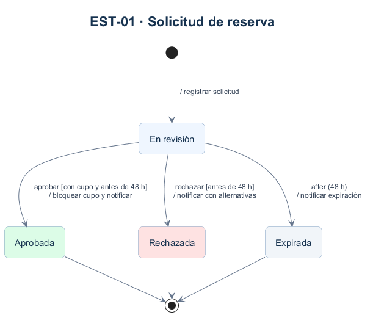
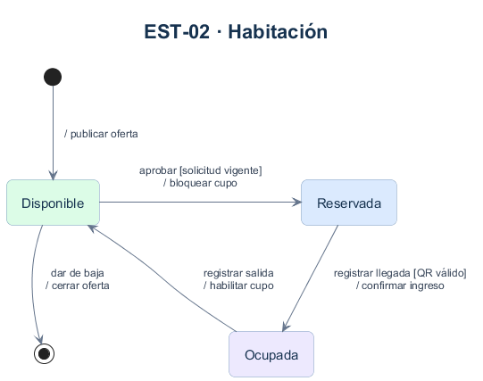

# Diagramas de estado

## EST-01 — Ciclo de vida de SolicitudReserva

- Clase: [SolicitudReserva](./08-modelo-dominio.md).
- Secuencia relacionada: [DSS-01](./10-diagramas-secuencia.md).

Archivo fuente: [est-01.puml](./diagramas/est-01.puml)

### Tabla de transiciones

| Origen | Evento | Guarda | Acción | Destino |
|--------|--------|--------|--------|---------|
| Inicio | Creación tras enviar una solicitud válida | — | Registrar solicitud y notificar al dueño | En revisión |
| En revisión | Aprobar | Habitación disponible y menos de 48 h desde el envío | Bloquear cupo y notificar aprobación | Aprobada |
| En revisión | Rechazar | Menos de 48 h desde el envío | Registrar motivo y notificar con alternativas | Rechazada |
| En revisión | after (48 h) | — | Notificar expiración | Expirada |
| Aprobada | Finalización | — | — | Fin |
| Rechazada | Finalización | — | — | Fin |
| Expirada | Finalización | — | — | Fin |

La creación requiere datos válidos y una habitación disponible según HU-02. El plazo se cuenta desde el envío. Consultar la solicitud o intentar aprobarla sin cupo conserva En revisión; se informa al actor sin cambiar el estado. Los estados finales cierran la evaluación, conservando el registro histórico.

Los rótulos breves **aprobar** y **rechazar** corresponden a `aprobarSolicitudReserva` y `rechazarSolicitudReserva` en DSS-01. La aprobación de la solicitud y el bloqueo de la habitación son una sola decisión.

## EST-02 — Ciclo de vida de Habitacion

- Clase: [Habitacion](./08-modelo-dominio.md).
- Secuencias relacionadas: [DSS-01 y DSS-02](./10-diagramas-secuencia.md).

Archivo fuente: [est-02.puml](./diagramas/est-02.puml)

### Tabla de transiciones

| Origen | Evento | Guarda | Acción | Destino |
|--------|--------|--------|--------|---------|
| Inicio | Creación tras publicar una oferta válida | — | Publicar oferta | Disponible |
| Disponible | Aprobar | Solicitud En revisión y menos de 48 h desde su envío | Bloquear cupo | Reservada |
| Reservada | Registrar llegada | QR válido y correspondiente a la reserva | Confirmar ingreso | Ocupada |
| Ocupada | Registrar salida | — | Habilitar cupo | Disponible |
| Disponible | Dar de baja | — | Cerrar oferta conservando historial | Fin |

**Solicitud vigente** significa En revisión y dentro del plazo de 48 horas. **QR válido** incluye autenticidad y correspondencia con la reserva presentada. Si la verificación falla, la habitación permanece Reservada y se informa el error. Rechazar otra solicitud no modifica la habitación.

Reservada significa que el cupo está comprometido; Ocupada, que el estudiante ya llegó. Aprobar corresponde a `aprobarSolicitudReserva` en DSS-01; la validación del QR se relaciona con DSS-02. Publicación, registro de salida y baja completan el ciclo propuesto y requieren validación del equipo, pues no están desarrollados en esas secuencias.
